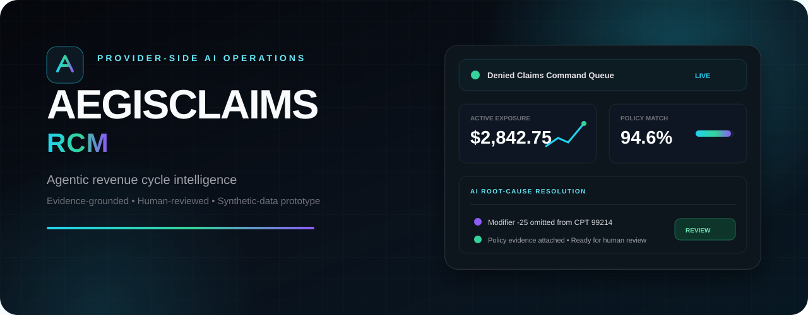
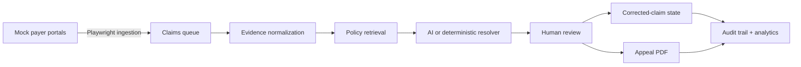

<p align="center">
  
</p>

<p align="center">
  <strong>Provider-side AI assistance for turning denied claims into policy-grounded, reviewable next actions.</strong>
</p>

<p align="center">
  
  
  
  
  
  
</p>

## Product demo

<p align="center">
  <a href="demo/aegisclaims-rcm-demo-480p.m4v"><strong>▶ Watch the AEGISCLAIMS RCM walkthrough</strong></a>
</p>

The repository includes a GitHub-friendly copy of the authentic product demonstration. It walks through the claims command queue, AI-assisted denial analysis, policy evidence, revenue analytics, integrations, and the audit trail.

## Why this project exists

Denied claims force provider billing teams to move between payer portals, EOBs, internal records, policy documents, and spreadsheets. AEGISCLAIMS RCM brings that work into one evidence-centered control plane while keeping a human reviewer in charge of every corrective action.

This prototype was created for a MainStreet Family Care interview project. It uses synthetic demonstration data only and is not connected to MainStreet Family Care systems, real patients, live payers, or clearinghouses.

## Workflow



## What the prototype demonstrates

- A unified claims queue across four simulated payer portals
- Claim-level evidence for CPT, diagnosis, modifier, authorization, and EOB signals
- Payer-policy retrieval backed by ChromaDB
- Structured denial recommendations with citations and confidence signals
- Deterministic offline resolution when no OpenAI key is configured
- Human approval before a claim enters a resolved or resubmission state
- Batch analysis for eligible claims
- Downloadable appeal PDFs
- Revenue-at-risk, recovery, denial, and payer analytics
- Searchable lifecycle audit logs
- Repeatable Playwright demo recording

## Product surfaces

| Workspace | Purpose |
| --- | --- |
| Claims Queue | Prioritize denials, inspect evidence, and review suggested corrections |
| Executive Analytics | Track exposure, recovery, payer mix, and denial concentration |
| Policy RAG Engine | Search indexed synthetic payer-policy passages |
| Integration Hub | Observe simulated portal and vector-store status |
| Audit Logs | Review claim analysis and resolution events |

## Architecture

```text
Browser dashboard
      │
      ▼
FastAPI application ───────────────► SQLite claims + audit data
      │
      ├──► Playwright mock-payer ingestion
      ├──► ChromaDB policy retrieval
      ├──► OpenAI structured resolution (optional)
      ├──► Deterministic resolver (offline fallback)
      └──► ReportLab appeal generation
```

## Technology

| Layer | Implementation |
| --- | --- |
| API and server | FastAPI, Uvicorn, Pydantic |
| Persistence | SQLAlchemy, SQLite |
| Retrieval | ChromaDB, LangChain text splitters |
| AI assistance | OpenAI Responses API with structured output |
| Automation | Playwright |
| Documents | ReportLab |
| Interface | Jinja2, JavaScript, Tailwind CSS, Chart.js |
| Quality | Pytest, HTTPX |

## Run locally

Requirements: Python 3.11+ and a Playwright-compatible environment.

```bash
git clone https://github.com/kushalsai09/aegisclaims-rcm.git
cd aegisclaims-rcm
python3 -m venv .venv
source .venv/bin/activate
pip install -r requirements.txt
playwright install chromium
cp .env.example .env
uvicorn app.main:app --reload
```

Open [http://127.0.0.1:8000](http://127.0.0.1:8000). The application creates its local SQLite and ChromaDB stores on first run.

`OPENAI_API_KEY` is optional. Without it, the application uses its built-in deterministic resolver so the core workflow remains demonstrable offline.

## Test the resolution pipeline

```bash
pytest -q
```

The test suite covers denial resolution, the claim-resolution pipeline, and analytics calculations.

## Repository map

```text
app/
├── analytics/       Revenue-cycle aggregations
├── mock_portals/    Synthetic payer portal pages
├── policies/        Synthetic payer-policy documents
├── rag/             Policy indexing, retrieval, and resolution
├── scraper/         Playwright portal ingestion
├── services/        Audit and appeal-PDF services
├── static/          Dashboard styles and behavior
└── templates/       Operations dashboard
demo/                Product walkthrough
scripts/             Repeatable demo-recording automation
tests/               Resolver, pipeline, and analytics tests
```

## Safety and project boundaries

- All names, claims, policies, portals, identifiers, and outcomes are synthetic.
- The system does not connect to real EHRs, payer systems, or clearinghouses.
- Recommendations are decision support and require human review.
- The prototype is not a production medical-billing system and is not presented as HIPAA-compliant.
- Secrets belong in `.env`; the repository includes only a safe `.env.example`.

---

<p align="center"><sub>Built as a portfolio demonstration of evidence-grounded, human-reviewed revenue-cycle automation.</sub></p>
